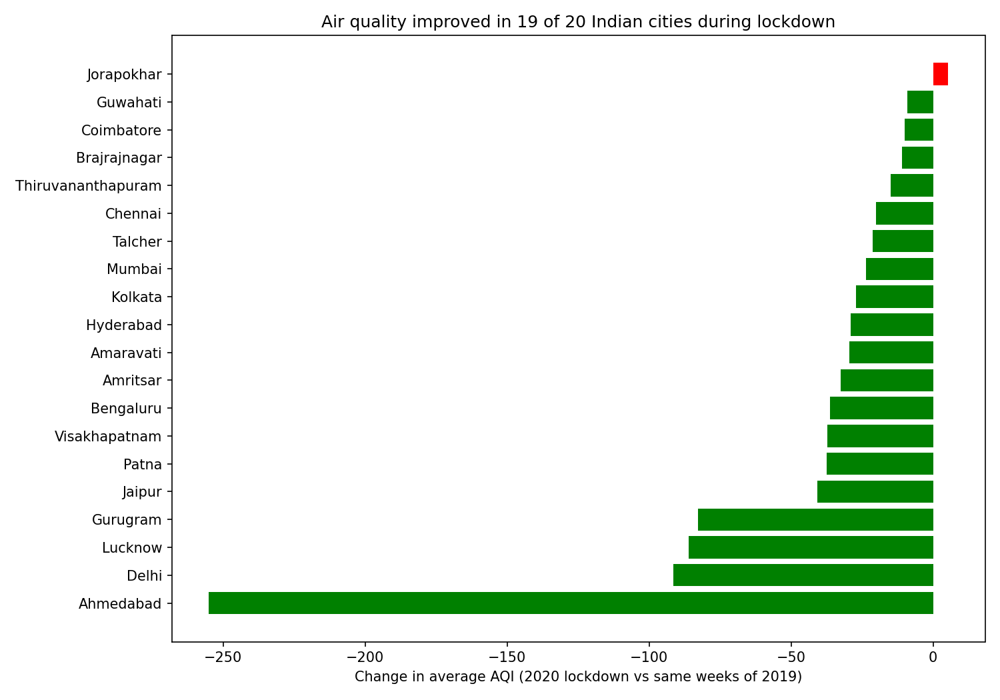

# Did India's 2020 Lockdown Really Clean the Air?

A Python and statistics analysis of daily Air Quality Index (AQI) data from 26 Indian cities, built with pandas, matplotlib and SciPy.

## Question

Which Indian cities have the worst air, and did air quality improve during the 2020 COVID-19 lockdown?

## Data

- Source: Kaggle dataset "Air Quality Data in India (2015-2020)", file `city_day.csv`
- Original source of the readings: Central Pollution Control Board (CPCB), Government of India
- 29,531 rows, one row per city per day, 16 columns

## Method

1. Loaded the data with pandas and converted `Date` from text to a real date type
2. Dropped rows with no AQI value
3. Found invalid readings: 543 rows had AQI above 500, which is the top of the official Indian AQI scale (412 of them were from Ahmedabad). I removed these rows
4. Compared average AQI per city for **25 March to 30 June 2020** (lockdown) against the **same dates in 2019**, so the season is the same in both
5. Kept only the 20 cities that have data in both periods
6. Ran a **paired t-test** (each city compared with itself) to check whether the change could be random chance

## Findings

- **19 of 20 cities** had lower average AQI during lockdown. Only Jorapokhar got slightly worse.
- Delhi fell from about 217 to 126, Lucknow from about 193 to 107, and Gurugram from about 209 to 126
- The paired t-test gave p = 0.002 with all cities, and p = 0.00003 without Ahmedabad. Both are below 0.05, so the improvement is statistically significant.
- Average improvement without Ahmedabad: about 33 AQI points

## Business Angle

**Who could use this:** an air-purifier company choosing which cities to target first, or a city authority deciding where emission controls matter most.

**What the data suggests:** Delhi (about 217 to 126), Gurugram (about 209 to 126) and Lucknow (about 193 to 107) had the largest drops in AQI during lockdown. Because AQI fell in 19 of 20 cities, human activity such as traffic and industry appears to have a large effect on air quality.

**Recommendation:** Cities with the highest normal AQI would gain the most from controls on traffic and industrial emissions. Product and policy efforts should start there.

## Limitations

- The test shows air quality improved, but it cannot prove lockdown was the only cause. Weather and other year-to-year changes also affect AQI.
- Ahmedabad's data looks unreliable even after removing readings above 500 (its 2019 average was very high), so I ran the test with and without it. The conclusion is the same either way.
- Many cities have data only for some years, and PM2.5 and PM10 values are often missing
- Only 20 cities had data in both periods, so this is a small sample

## Files

- `AQI_lockdown_analysis.ipynb`: full analysis notebook
- `city_day.csv`: data
- `lockdown_aqi_change.png`: chart

## Tools

Python, pandas, matplotlib, SciPy, Jupyter Notebook
